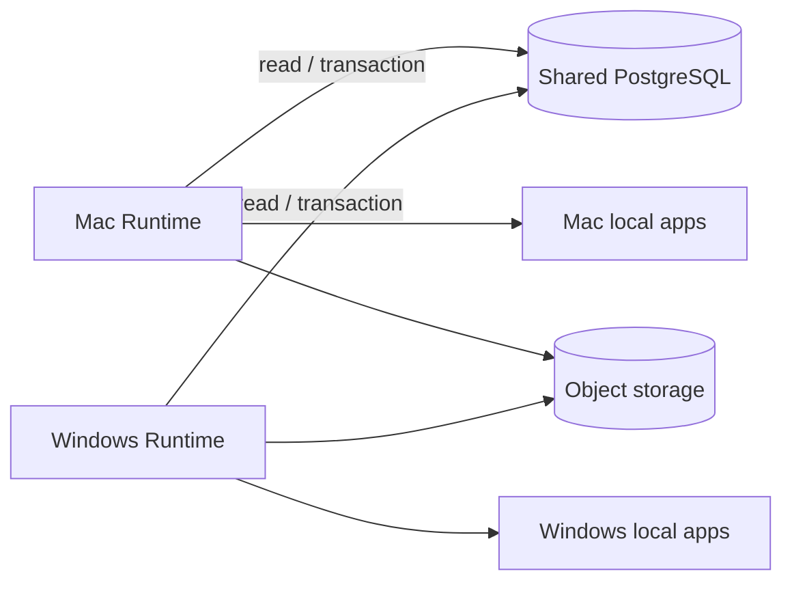

# 共享云数据与多设备 Runtime 方案

> 本文是目标架构，不代表当前代码已经实现。项目仍处于开发期，可以直接替换存储和 schema，不设计旧数据迁移或双写兼容层。

## 1. 目标

同一账号在 Mac 和 Windows 上各运行一个完整 Runtime。各端没有中央调度器，也不互相调用；它们只读取和写入同一份云端数据，并通过云端原子事务决定谁可以执行某件事。

“钥匙”是数据库中的执行所有权记录：

1. 任意设备都可发现待执行工作。
2. 只有通过条件更新取得有效 lease 的设备可以执行。
3. 所有设备只需保证本机单实例。
4. 同一逻辑工作使用稳定 `execution_key`，云端唯一约束保证只创建一次。
5. lease 过期后其他兼容设备可以接管；旧持有者的迟到结果会被 fencing token 拒绝。

## 2. 数据边界

### 云端共享

- event log、领域投影、Work、审批、通知和执行状态；
- 定时器定义、逻辑触发时刻和执行结果；
- 设备注册、心跳、能力清单；
- 应用/账号连接的非敏感元数据和设备绑定；
- 可跨设备复用的 memory embedding；
- 用户偏好、目标、连接器规则和审计记录。

推荐 PostgreSQL 作为唯一事务权威，pgvector 存 memory embedding。大附件或工具 spill 放对象存储，只在 PostgreSQL 中保存内容摘要、对象 key、大小和校验值。

### 仅设备本地

- OAuth refresh token、应用密码、系统钥匙串引用；
- 文件绝对路径、应用安装路径、窗口句柄；
- OS 权限的实际授权，例如辅助功能、屏幕录制和通知权限；云端仅保存最近一次探测摘要；
- 短期缓存、下载文件、日志和本机单实例锁。

建议密钥在 macOS Keychain 或 Windows Credential Manager 中保存。云端只保存无敏感内容的 `credential_ref` 和设备归属。每台设备分别授权；复制 connection 元数据不等于获得账号访问权。这是待实现的凭据方案，不是用户已确认的存储限制。

### 外部应用仍是来源

Apple Mail、Outlook、Gmail、系统日历等外部应用的数据来源地位不变。Runtime 云端保存同步游标、规范化摘要、用户规则和审计，不把自己的副本宣称为外部系统的最终真相。

## 3. 与当前实现的对比

| 关注点 | 当前 snapshot | 目标 | 处理 |
|---|---|---|---|
| 权威数据库 | 每设备 SQLite | 共享 PostgreSQL | 替换 |
| 向量索引 | 每设备 Chroma | PostgreSQL + pgvector | 替换 |
| Runtime 数量 | 数据库级单实例 | 每设备单实例，多设备并行 | 重构锁边界 |
| 执行身份 | 固定 `runtime:primary` | 稳定 `device_id` + 每次启动 `session_id` | 重构 |
| 执行 claim | 进程内 pending/active | 数据库原子 claim + lease + fencing | 重构 |
| 定时器 | 本机扫描后执行 | 所有设备可扫描，逻辑 fire 全局唯一 | 重构 |
| 失败接管 | 本进程恢复 stale running | lease 过期后兼容设备接管 | 重构 |
| 邮件/日历 | 单组内建配置 | Application / Connection / DeviceBinding | 新建模型 |
| 凭据 | env 或本地 `app_settings` 密文，已支持 OS 密钥保护 | 云端配置与逐设备 credential ref 分离 | 复用保护机制，重构归属 |
| 认证 | 可选单 Bearer token | 用户会话 + 设备身份 | 重构 |
| 同步 | 备份/恢复与独立本地数据库，无实时共享协议 | 共享权威数据，设备仍需追赶事件并刷新缓存/UI | 重构 |
| Kernel/治理 | 单写入口、审批、审计 | 继续保留 | 适配 SQL 与身份 |
| Product Work | `work_items` | 继续保留 | 小改 |

## 4. 必须成立的不变量

### 数据一致性

- 命令回执按 `(account_id, command_id)` 唯一，记录请求摘要、状态和结果引用。相同 id、相同输入返回已有结果或 pending；相同 id、不同输入拒绝。一个 command 可以产生多个事件，事件表上的 `command_id` 不能单独唯一。
- 每个 aggregate 维护 `aggregate_version`；条件更新预期版本并以 `(account_id, aggregate_type, aggregate_id, aggregate_version)` 唯一约束阻止覆盖。
- 首版继续让事件和领域投影在同一短 PostgreSQL 事务中提交。事件事务先锁定该账号的 stream-head 行，再增加事务性计数器、写事件及投影，锁持有至提交；跨账号不需要总序。所有写入口遵循同一锁顺序。
- 普通 `IDENTITY`/sequence 只生成标识，不能当作提交顺序：事务 A 取到 10 未提交，B 的 11 可以先提交；若消费者推进到 11，就可能永远跳过稍后提交的 10。上述串行化写入是首版对持久游标的保障，事务内不得调用 LLM、网络或本地应用。[PostgreSQL sequence 文档](https://www.postgresql.org/docs/current/functions-sequence.html)说明 sequence 不随事务回滚；这里的提交乱序是其并发使用的推论。

### 执行一致性

- `execution_key` 表示逻辑工作身份并全局唯一，例如 `timer:{timer_id}:{scheduled_at}`、`event:{event_id}:{handler_name}`。
- claim 必须是一条带条件的原子 SQL，不能先查再改。
- 每次 claim 生成该 execution 内单调递增的 `fencing_token`。在 Kernel 事务入口检查 owner/session/token、有效期、状态和取消意图，再追加事件及更新投影；不能等事件已经入日志后才在 projector 丢弃旧 token。历史 replay 不读取当前时钟或重新取得执行权。
- claim/renew/expiry 使用数据库时间。断网或无法确认续租时停止发起新效果；恢复后重新查询权属。heartbeat 只表明设备活跃，不授予 execution 所有权。租约频繁续期属于 Kernel 管理的运行状态，必须显式登记治理例外；重建不得复活历史 running lease，应在维护模式下使旧 session/token 失效。
- lease 到期只表示可以接管，不代表旧执行绝对停止。
- 外部系统通常无法提供严格 exactly-once。执行结果需要 `succeeded`、`failed`、`unknown` 三种结论；对邮件发送、日历写入等操作使用 provider idempotency key 或执行后对账。
- 一次 execution 可以包含多个外部效果。按 `(account_id, execution_key, step_key)` 记录 effect intent、参数摘要、审批引用、provider operation id 和结果；幂等键跨重试保持稳定，不能包含 fencing token。发送成功但回写失败时先对账；目标不支持幂等且无法确认结果时转人工处理，不能自动重发。数据库 fencing 无法阻止已发往外部应用的旧请求。
- 每项工作声明 `shared_once`、`per_device` 或 `target_device`；设备维护和本地权限探测使用包含 device id 的 key，不能被全局去重吞掉。终态记录删除后须保留幂等 tombstone 或明确重放保留期。

### 设备与能力

- `device_id` 安装时生成并持久化，`session_id` 每次进程启动生成。
- 设备定期上报心跳、OS、应用安装、连接、权限和能力版本。
- 任务只允许被满足 `required_capabilities`、`required_connection_id` 和可选 `target_device_id` 的设备 claim。
- UI 必须显示等待原因，例如“仅 MacBook 的 Apple Mail 连接可执行，设备当前离线”。

## 5. 目标数据模型

继续使用现有事件与 Work 模型，扩展而不是增加第二套任务总线。

### event_log

增加：

- `command_id`，非唯一，引用命令回执；事件自身仍有唯一 event id；
- `aggregate_version`，与 `account_id + aggregate_type + aggregate_id` 组成唯一约束；
- `account_id`；
- `origin_device_id`；
- `stream_seq`，由账号 stream-head 行在事务中分配，唯一键为 `(account_id, stream_seq)`；不能用裸 identity 代替。

新增命令回执和 stream-head 协调记录；它们服务现有事件/Work，不构成第二套任务总线。所有共享表、唯一键、对象路径和查询都必须带账号作用域。

### handler_executions

保留为唯一的调度 Work 表，增加：

- `execution_key`，唯一；
- `owner_device_id`、`owner_session_id`；
- `lease_expires_at`、`heartbeat_at`；
- `fencing_token`；
- `required_capabilities_json`、`required_connection_id`、`target_device_id`；
- `result_state`；步骤级 provider 操作和 `reconcile_after` 放在 effect receipt 中，避免一个 execution 只能记录一次效果。

当前固定 `instance_id` 被设备/session 所有权替代。终态清理可以保留，但不能删除仍可能用于幂等或外部效果对账的记录。

### timer_events

将“定时器定义”和“某次触发”分开：

- timer definition 保存 cron、时区、handler、payload 和 enabled；
- 每次逻辑触发创建具有唯一 `execution_key` 的 `handler_executions`；
- 多台设备都可以扫描，唯一约束使同一触发只产生一个逻辑执行。
- key 包含账号、timer id、schedule revision、UTC scheduled time 和执行作用域；时区独立存储。定义修改、停用、夏令时和离线补跑采用明确策略：首版周期摘要合并遗漏窗口，逐次任务设置最大补跑数，不无限追赶。

### devices

保存 `device_id`、名称、OS、Runtime 版本、最后心跳、状态和 capability inventory。它是共享运行状态，不保存本地密钥。

### application_connections

表达用户连接的逻辑账号，例如“工作邮箱”“个人日历”，字段包括 provider、能力、账号标识、同步状态和共享配置。

### device_bindings

把 connection 绑定到具体设备应用，例如：

- Mac：`mail.apple-mail`；
- Windows：`mail.outlook`；
- 通用回退：`mail.imap-smtp`。

记录安装状态、权限、`credential_ref`、优先级和最近健康检查。若 Windows 没有合适客户端，产品层根据 provider 给出 Outlook、Thunderbird 或通用 IMAP/SMTP 的配置引导；选择由用户完成，Runtime 不把某一客户端硬编码为唯一答案。

Application 还需要一个版本化能力清单，区分独立内建应用、桌面应用、账号服务和 MCP provider。安装、账号授权、OS 权限、健康检查分别建模；只有该设备实测可用的能力才能进入领取条件。

Outlook 必须区分新版和经典版，不能承诺通用的 Windows COM adapter。微软明确说明新版 Outlook 不支持 COM/VSTO add-in；adapter 需逐版本验证，Graph/API 连接和本地 UI 操作也应独立标识。[官方说明](https://learn.microsoft.com/en-us/office/dev/add-ins/outlook/one-outlook)。安装引导来自受维护的官方链接，并允许用户直接连接邮件服务、暂时跳过或选择其他客户端。

外部对象用 connection/account + provider object id 标识，保存同步游标、版本和删除标记；IMAP 需包括邮箱及 UIDVALIDITY/UID。不能以本地路径或邮件主题作为跨设备去重键。目标/任务保留可独立启用的内建应用，同时允许外部任务应用提供事实来源；每个对象明确权威来源和冲突规则，禁止双向覆盖循环。

## 6. 代码重构地图

### 第一组：存储地基

| 当前位置 | 修改 |
|---|---|
| [config.py](../backend/app/config.py) | 用 `DATABASE_URL`、`DEVICE_ID`、对象存储配置替代 `SQLITE_PATH` / `VECTOR_DIR` 权威配置 |
| [database.py](../backend/app/store/database.py) | 引入 PostgreSQL pool、事务和 SQL 参数适配；把文件锁拆成纯本机 Runtime 锁 |
| [schema_ddl.py](../backend/app/store/schema_ddl.py) | 用 PostgreSQL schema 重写，不保留 SQLite 兼容分支 |
| [table_registry.py](../backend/app/store/table_registry.py) | 更新表和字段契约，移除“distributed lease non-goal” |
| [vector.py](../backend/app/store/vector.py) | 替换为 pgvector repository；保留持久化 embedding pending/retry 职责，删除 Chroma 专用修复 |
| `backend/alembic/` | squash 为新的初始 schema，不写旧库迁移 |

建议先建立 store protocol 和 PostgreSQL 实现，再改 Kernel SQL。不要长期维护 SQLite/PostgreSQL 双后端。

pgvector 只解决向量存储，embedding 生成仍可能失败。模型调用在事务外完成，按 memory 内容版本、model/version、维度和 content hash 条件写入，拒绝过期向量；查询使用同一 embedding 模型。原修复队列可改造或被共享 execution 取代，不能直接消除重试职责。对象上传同样不与数据库原子提交，需要 pending/ready、校验、重试与孤儿清理。

### 第二组：共享执行权

| 当前位置 | 修改 |
|---|---|
| [agent_scheduler.py](../backend/app/core/runtime/agent_scheduler.py) | 去掉固定 `runtime:primary` 所有权；新增数据库 claim、renew、complete、fail 与 fencing 校验 |
| [runtime_loop.py](../backend/app/core/runtime/runtime_loop.py) | 扫描共享 pending/expired lease；心跳设备和已取得的 execution |
| [cron_registry.py](../backend/app/core/runtime/cron_registry.py) | cron 只负责提出逻辑 fire；通过唯一 execution key 去重 |
| [execution_events.py](../backend/app/core/runtime/execution_events.py) | 事件 payload 加 device/session/lease/fencing/result state |
| Kernel execution projectors | 用条件更新拒绝旧 fencing token 的迟到写入 |
| 取消/死信/续跑路径 | 以 `execution_key` 和当前 fencing token 判断当前尝试 |
| [event_dispatch.py](../backend/app/core/runtime/kernel/event_dispatch.py) | 提交后的本机派发改为持久事件扫描；创建全部 handler execution 与推进持久 cursor 同事务，按 handler/version 去重 |
| `submit_command` / SSE / WebSocket | 本机 Future 和广播仅作加速；轮询云端 command result / event cursor 以接收其他设备完成结果；流式 token 首版固定来源设备，断线可读最终结果 |

Scheduler 仍可保留本机 `_active` 集合做并发控制，但它只是本机缓存，不能决定共享所有权。

必须覆盖“事件已提交、尚未派发就崩溃”的窗口。timer handler 当前还会启动 fire-and-forget 网络任务，这些实际工作应变成受 lease 约束的持久 execution，不能在父任务结束后脱离执行权。审批和取消也要通过共享状态原子消费；审批绑定账号、connection、具体效果和参数摘要，换设备不等于允许更换发送账号或动作内容。

### 第三组：设备、认证和应用连接

| 当前位置 | 修改 |
|---|---|
| [main.py](../backend/app/main.py) | 启动时注册 device/session，停止时标记 session，后台续心跳 |
| Auth middleware / principal | 区分 user、device 和 system actor；每个写入带 account/device 上下文 |
| [connectors.py](../backend/app/api/connectors.py) | 返回真实 Application / Connection / DeviceBinding 状态，删除固定 connected 响应 |
| `builtin_tools/email.py` | 拆出 Apple Mail、Outlook、通用 IMAP/SMTP adapter，共享统一 mail capability |
| `builtin_tools/calendar.py` | 拆出 EventKit/Apple Calendar、Windows/Outlook、ICS 或 CalDAV adapter |
| runtime config / settings API | 把同步配置写云端，把 credential 写系统凭据库 |
| Electron | 首次安装生成 device identity；展示应用发现和 OS 权限引导 |

应用 adapter 是能力实现，不是新的调度器。Scheduler 根据 binding 选择设备，取得 lease 的设备再调用本机 adapter。

### 第四组：删除单机同步遗留

- 删除“导出完整 event log → 在另一设备 destructive restore”作为同步机制；
- 删除 Chroma 专用 repair、SQLite path 修复和 SQLite 专用 snapshot 打包，保留通用 embedding 生成失败重试；
- 将文件 spill 改为对象存储引用，或明确标记为只在来源设备可取；
- 拆分 `app_settings`：共享偏好进入 governed/shared state，本机秘密进入 credential store，本机缓存进入 local state；
- 更新 Docker、安装器和桌面启动，要求登录共享数据空间，而不是创建独立本地数据库。

### 第五组：产品可见性

前端增加设备与连接管理页，并在任务/审批/时间线显示：

- 计划执行设备和实际执行设备；
- lease 状态、接管次数和等待原因；
- 使用的 application connection；
- 外部效果的 confirmed/unknown/reconciled 状态；
- 设备离线、应用未安装和权限缺失的修复动作。

## 7. 实施顺序与完成标准

### Phase 1：云数据单 Runtime

先让一台设备完整运行在 PostgreSQL + pgvector 上。存储集成测试改用隔离 PostgreSQL schema；不依赖数据库的单元测试继续使用 fake。SQLite 和 Chroma 从生产路径移除。此阶段限制每账号一个活跃 Runtime，Phase 2 验收前不能开放多设备共享写入。

完成标准：重建、审批、对话、memory、收件箱、project brief 和工具审计在新存储上通过。

### Phase 2：多设备竞争执行

加入 device/session、execution key、原子 claim、renew、过期接管和 fencing。

完成标准：

- 两个 Runtime 同时扫描只产生一个逻辑 timer execution；
- 两个 Runtime 竞争时只有一个取得 lease；
- owner 崩溃后另一设备接管；
- 旧 owner 恢复后无法提交迟到结果；
- 定向设备和 required capabilities 会阻止错误设备领取。
- 事件提交后崩溃仍会生成 execution；其他设备完成后，发起设备的 command/UI 能收到结果；
- 乱序提交、一个命令多事件、并发审批/取消、断网续租、定时器时区/补跑均有双连接或多进程集成测试；
- 外部效果至少具备持久 intent、稳定幂等键和 unknown 禁止盲重试规则，之后才能开放真实写操作。

### Phase 3：本地应用连接

先做邮件垂直切片：Apple Mail、Outlook、IMAP/SMTP 共享同一 mail capability 和 connection 模型，再按相同模式接日历。

完成标准：同一“发送邮件”意图可以按绑定路由到 Mac 或 Windows；未安装/未授权/离线都有明确状态和引导；凭据不会进入云端事件。

### Phase 4：外部效果可靠性

完善各 provider 的自动 reconciliation。基础 intent、幂等和 unknown 规则已是 Phase 2/3 的前置条件，不能到此阶段才加入。

完成标准：模拟网络在请求成功后断开，系统不会盲目重复操作，并能通过对账收敛到 confirmed 或需要人工处理。

### Phase 5：自主技术助理

在共享执行地基稳定后，再增加项目观察、issue/PR/CI 触发和编码执行器。它们继续写入现有 Work，并通过同一个 `handler_executions` 与 Capability governance 执行，不能建立另一套 Agent task bus。

## 8. 首批建议改动

第一个实现 PR 应限定为“PostgreSQL 单设备基线”：

1. 建立新 schema 和 PostgreSQL store；
2. 改 Kernel 与 read ports 的事务/查询；
3. 用 pgvector 替换 Chroma；
4. 保留每台设备单实例锁；
5. 删除 SQLite/Chroma 生产路径；备份导出保留，restore 改为停机维护流程，禁止把历史 lease 当作当前执行权恢复；
6. 建立 PostgreSQL 测试 fixture。

第二个 PR 再引入 device identity 和共享 execution lease。这样可以先分离“SQL 方言/存储替换”与“分布式执行语义”，失败时更容易定位。

## 9. 部署与权限边界

云端数据库连接使用 TLS 和账号/设备范围的最小权限，不把管理员数据库密码打包进桌面端。首版可让每个受信任 Runtime 直接连接数据库，通过受限数据库角色、账号隔离策略和事务函数约束写入；若后续使用无状态数据 API，它只代理相同事务，不承担调度或所有权。设备撤销必须撤销对应凭据/会话，不能只在 devices 表标记 offline。

共享缓存、MCP 能力列表和策略需按版本失效；接管设备若缺少对应 handler/schema/plan 版本，应等待或拒绝，不能用新版本代码解释不兼容旧计划。开发期不迁移旧数据不意味着运行中的多设备可以忽略版本兼容。

实施时还需同步 `check_single_process_control_plane`、`PHILOSOPHY_EXCEPTIONS`、投影来源/重建和概念增长守卫。当前单进程脚本仅检查部分静态入口，上一轮修改的提示文字没有使它具备设备单实例或分布式一致性验证能力；这些能力要靠进程锁测试与多进程数据库测试证明。

离线时允许查看明确标注时间的缓存和编辑本地草稿；需要全局唯一性的自动动作暂停。云端恢复后先刷新权属、审批和取消状态，再开始工作。自动推进还需要共享预算、允许的项目范围、停止开关和人工审查规则，避免多个不同 execution 同时耗尽预算。

## 10. 二次 Review 记录（2026-10-23）

本轮修正的是设计文档及工程指引，以下运行时改造尚未实施。

| 严重度 | 上一版问题 | 本轮修正 |
|---|---|---|
| P1 | 把 PostgreSQL identity 称为提交序，持久游标可能漏读迟提交事件 | 账号 stream-head 事务串行化；明确 sequence 与提交顺序不同 |
| P1 | event_log.command_id 唯一使一个命令只能发一个事件 | 独立命令回执唯一，事件多对一引用 |
| P1 | 仅在 projector 拒绝旧 token，非法事件可能先进入权威日志 | Kernel 事务入口检查权属；区分实时写入与历史 replay |
| P1 | 只改 Scheduler，遗漏提交后派发丢失和跨设备 Future/UI | 持久扫描与 cursor、跨设备结果读取、流式来源约束 |
| P1 | 效果幂等放到 Phase 4，Phase 2/3 已可能重复发送 | 提前引入步骤回执、unknown 与禁止盲重试；自动对账后续完善 |
| P2 | 更换 pgvector 后直接删除修复队列 | 保留 embedding 生成的持久重试、版本校验和模型一致性 |
| P2 | 未区分共享一次、每设备一次、指定设备 | 执行 scope、设备时间/断网/补跑/保留期规则 |
| P2 | Outlook 当成统一 adapter，内建目标应用和来源冲突未覆盖 | 版本化应用清单、独立内建应用、外部对象 id 与来源规则 |
| P2 | 数据库认证、撤销、缓存追赶和混合版本缺失 | 最小权限、账号隔离、设备凭据撤销、版本与缓存刷新 |
| P2 | 旧 harness 要求 fire-and-forget，与共享 lease 矛盾 | 修改 SOP；实际后台工作进入持久 execution |

验证范围：文档/生成参考、当前代码静态守卫及 SQLite 投影重建可以验证本次文档调整；它们不能证明尚未实现的 PostgreSQL claim、外部应用 adapter 或多设备接管正确。目标阶段验收必须使用真实 PostgreSQL 多连接/多进程测试，并分别在 Mac 与 Windows 验证应用能力。

本轮实际验证：完整后端 2019 passed、4 failed、9 skipped、7 deselected。发现并修复 docs/README 缺少版本号导致的版本一致性失败；版本测试与两项简报测试在显式设置测试进程 `ALLOW_CLOUD_PERSONAL_DATA_EGRESS=false` 后合计 7 passed，说明简报测试未充分隔离外发策略环境。剩余 `test_config_persisted_to_db` 对 Windows 文件要求 POSIX 0600 模式，当前平台实际返回 0666；应改为平台对应的权限/密钥保护验证，不能据此宣称 Windows ACL 暴露。两项环境隔离问题和平台断言作为现有测试债记录，本次未改业务策略或用户配置。lint、文档守卫、生成物、边界、层依赖、概念基线、投影来源与重建通过；修正后未重跑全量后端。
